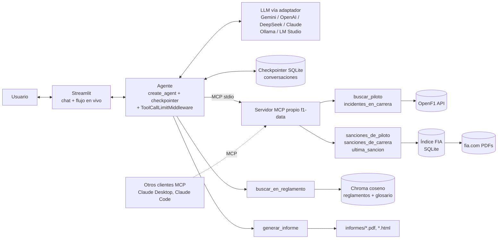

# Agente de sanciones de F1

Agente de IA que **explica sanciones de Fórmula 1 con el reglamento en la mano**: busca la
decisión oficial de los comisarios de la FIA, trae el texto de los artículos infringidos del
reglamento vigente en esa temporada, explica por qué se aplicó la sanción y genera un informe.

Trabajo Integrador · Modelos de Lenguaje · UTN FRM · 2026

## Ejemplo de tarea

> "¿Por qué sancionaron a Bearman en São Paulo 2026? Armame un informe."

1. `buscar_piloto("Bearman", 2026)` → auto 87, TGR Haas F1 Team (OpenF1)
2. `sanciones_de_piloto(2026, "São Paulo Grand Prix", 87, "Bearman")` → reprimenda, Art. B1.6.3b (FIA)
3. `buscar_en_reglamento("reversing in the pit lane", 2026, "B1.6.3b")` → texto del artículo (RAG)
4. `incidentes_en_carrera(2026, "Sao Paulo", 87)` → secuencia en Race Control (OpenF1)
5. `generar_informe(...)` → `informes/2026...-gran-premio-de-sao-paulo-2026.pdf` (y `.html`), descargables desde el chat

## Arquitectura



| Componente | Dónde | Por qué está |
|---|---|---|
| Agente (`create_agent`) | `agente_f1/agent.py` | Orquesta el flujo de varios pasos con tool calling |
| Memoria (checkpointer SQLite) | `agente_f1/conversaciones.py` | Cada conversación es un `thread_id` guardado en `data/conversaciones.sqlite`: el agente sigue sobre turnos anteriores ("¿y en qué sesión fue?") y las conversaciones sobreviven a reinicios. La UI reconstruye el historial desde esos mismos mensajes |
| Adaptador de LLM | `agente_f1/llm/` | "Traé tu propio modelo": misma interfaz para Gemini, OpenAI, DeepSeek, Claude y modelos locales (Ollama, LM Studio); normaliza el razonamiento para la UI |
| "Traé tu propia clave" | `app.py` (selector "Modelo") | El usuario elige proveedor y modelo y carga su clave; queda solo en la sesión del navegador (no se guarda en disco ni se comparte entre sesiones). Si no la carga, se usa la del `.env` |
| Servidor MCP propio `f1-data` | `agente_f1/mcp_f1/` | Expone las 5 tools de datos de F1 (FIA + OpenF1) por MCP: el agente las usa como cualquier cliente, y el mismo servidor se puede conectar a Claude Desktop, Claude Code u otro cliente MCP |
| Fuente FIA | `agente_f1/fuentes/fia/` | La decisión oficial (motivo, artículos) solo está en los PDFs de la FIA. Índice local en SQLite; solo se bajan los PDFs que se necesitan |
| Fuente OpenF1 | `agente_f1/fuentes/openf1.py` | Nombre → número de auto; secuencia de Race Control; detectar carreras nuevas para actualizar el índice |
| RAG del reglamento | `agente_f1/rag/` | El texto del reglamento por año no está en el modelo. Corpus de 7 documentos (reglamentos 2025 y 2026, Código Deportivo Internacional y su Apéndice L de 2025 y 2026, y un glosario propio). Párrafos por inciso + similitud del coseno; se cita el inciso exacto (ej. B1.6.3b) |
| Glosario propio | `data/reglamento/glosario.md` | Contenido del grupo: ~40 términos explicados para un fan nuevo, con su nombre en inglés. Entra al RAG como un documento más y lo usa el agente para explicar en simple |
| Informe (PDF y HTML) | `agente_f1/informe/` | Resultado tangible: portada, resumen tipo torre de tiempos y una ficha por sanción con la regla aplicada y glosario. El modelo escribe solo los textos en simple; la decisión, el artículo, la fecha, el link y el texto del reglamento salen de las fuentes |
| Middleware: `ToolCallLimitMiddleware` (LangChain) | `agente_f1/agent.py` | Único middleware. Limita a 6 búsquedas en el reglamento y 20 llamadas a tools por pregunta. Un modelo de razonamiento llegó a hacer ~30 búsquedas seguidas de un artículo que no estaba en el corpus; el prompt lo desalienta pero no lo garantiza, y el middleware corta donde el grafo ejecuta la tool, sin depender del modelo. No se resolvió con código propio porque haría falta contar llamadas por ejecución dentro del grafo, que es justo lo que este middleware ya hace |
| UI | `app.py`, `.streamlit/config.toml` | Mismo estilo que el informe (barra lateral oscura, Barlow / Barlow Condensed / JetBrains Mono, acento rojo). Conversaciones a la izquierda; chat en markdown con un bloque desplegable "Razonamiento" que muestra en vivo el razonamiento y cada tool (argumentos y resultado en JSON) |

TODO (grupo): completar la justificación de cada componente para la defensa.

## Instalación

Requisitos: Python 3.11+ y `pdftotext` (poppler).

```bash
# pdftotext (leer PDFs) y Pango (WeasyPrint, para generar el informe en PDF):
# Linux: sudo apt install poppler-utils libpango-1.0-0 libpangoft2-1.0-0
# macOS: brew install poppler pango
# Windows: conda install -c conda-forge poppler  (y para el PDF del informe, GTK3 runtime:
#          https://doc.courtbouillon.org/weasyprint/stable/first_steps.html#windows).
#          Sin Pango el informe se genera igual en HTML, que se imprime a PDF desde el navegador.

python -m venv .venv
source .venv/bin/activate          # Windows: .venv\Scripts\activate
pip install -r requirements.txt
```

## Configuración

```bash
cp .env.example .env
```

Completar en `.env` (no se commitea):
- `GOOGLE_API_KEY`: **obligatoria** (embeddings del reglamento, y Gemini si se usa como chat).
- `LLM_PROVIDER`: `gemini`, `openai`, `deepseek`, `anthropic`, `ollama` o `lmstudio` (por defecto).

Las claves de los proveedores de chat son opcionales en el `.env`: desde la UI (botón **Modelo**,
arriba a la derecha) se elige proveedor y modelo y se carga la clave solo para esa sesión.

**Modelos locales.** Con [Ollama](https://ollama.com) (`ollama pull qwen3:8b`) o
[LM Studio](https://lmstudio.ai) (servidor local activado) no hace falta clave: se elige
"Local · Ollama" o "Local · LM Studio" en la UI. El modelo tiene que soportar tool calling.

### Razonamiento por proveedor

| Proveedor | Cómo se obtiene | Se muestra en la UI |
|---|---|---|
| Gemini | `include_thoughts=True` (resumen del razonamiento) | Sí |
| OpenAI | Responses API, `reasoning.summary="auto"` (modelos de razonamiento) | Sí |
| Anthropic | Extended thinking (`thinking.budget_tokens`) | Sí |
| DeepSeek | `reasoning_content` (solo `deepseek-reasoner`) | Sí con reasoner; `deepseek-chat` no razona |
| Ollama | `reasoning=True` (modelos con razonamiento, ej. qwen3) | Sí |
| LM Studio | API compatible con OpenAI: no devuelve el razonamiento | No (solo las tools) |

TODO: verificar cada proveedor con el modelo final elegido.

## Datos

### 1. Índice de documentos de la FIA

```bash
python scripts/indexar_fia.py        # una vez, ~35 min (respeta el Crawl-delay de 10 s de fia.com)
```

Guarda título y URL de cada documento de 2019 en adelante en `data/fia_cache.sqlite`.
Los PDFs se bajan recién cuando el agente los necesita y quedan en el caché.
Después de cada fin de semana de carrera no hace falta volver a correrlo: antes de cada consulta
se pregunta a OpenF1 si hubo sesiones desde la última sincronización y, si hubo, se actualiza
solo esa carrera (1 pedido a la FIA).

### 2. Corpus del RAG

| Archivo en `data/reglamento/` | Documento | Descarga |
|---|---|---|
| `2026_f1_regulations_section_b_sporting_iss09.pdf` | 2026 Formula 1 Regulations – Section B [Sporting], Issue 09 | [fia.com › Formula One](https://www.fia.com/regulation/category/110) |
| `2025_f1_sporting_regulations_iss05.pdf` | 2025 Formula 1 Sporting Regulations, Issue 5 | ídem |
| `2026_international_sporting_code.pdf` | Código Deportivo Internacional 2026 (se usan los artículos 11 a 15: oficiales, infracciones y penalizaciones, protestas, revisión, apelaciones) | [fia.com › International Sporting Code](https://www.fia.com/regulation/category/123) |
| `2025_international_sporting_code.pdf` | Código Deportivo Internacional 2025 | ídem |
| `2026_isc_appendix_l.pdf` | Apéndice L 2026 (se usa el Capítulo IV, código de conducción) | ídem |
| `2025_isc_appendix_l.pdf` | Apéndice L 2025 | ídem |
| `glosario.md` | Glosario propio del grupo (está en el repo) | — |

Los PDFs no se suben al repo: se descargan de los links y se guardan con esos nombres
(el año adelante define la temporada). Después:

```bash
python scripts/ingestar_reglamento.py              # agrega lo que falta
python scripts/ingestar_reglamento.py --max 800    # como mucho 800 párrafos en esta corrida
python scripts/ingestar_reglamento.py --desde-cero # borra la base y carga todo
```

El corpus completo son ~2.400 párrafos. El tier gratuito de `gemini-embedding-001` permite
**100 embeddings por minuto y 1.000 por día**, compartidos con las búsquedas del agente (1 por
búsqueda). Por eso la ingesta:
- va en lotes de 50 cada 31 s;
- es incremental y se puede cortar y retomar: cada párrafo tiene un id fijo y solo se
  calculan los embeddings que faltan;
- carga primero lo más usado (glosario, Apéndice L, reglamento 2026) y lo más grande al final;
- si llega al límite diario se detiene sin error: se vuelve a correr al día siguiente.

Con una sola clave gratuita, el corpus completo se carga en 3 días. Conviene usar `--max`
para dejar cupo a las búsquedas (por ejemplo `--max 800` deja ~200 búsquedas ese día).

**Formatos.** Se detectan por el contenido:
- Reglamento de F1: artículos `B1.6.3` / `48.1`, incisos `a.` / `a)`.
- Código Deportivo Internacional: el PDF es bilingüe en dos columnas; se extrae solo la de
  inglés. Artículos `12.2.1.i`.
- Apéndice L: también bilingüe; se toma solo el Capítulo IV (código de conducción en pista),
  que es el que citan los comisarios ("Appendix L Chapter IV Article 2 d)").
- Glosario: cada `## Término` es un párrafo, válido para todas las temporadas.

**Chunking por párrafo.** Cada párrafo es un inciso de un artículo (`B1.6.3b`), con sus
sub-incisos (`i.`, `ii.`) adentro; el texto de un artículo sin incisos se corta en las líneas
vacías. Es la granularidad con la que citan los comisarios ("Breach of Article B1.6.3b").
Antes de calcular el embedding se le antepone la cita y el título del artículo, porque un
inciso suelto tiene poco contexto:

```
B1.6.3b · Driving in the Pit Entry Road, Pit Lane And Pit Exit Road
At no time may an F1 Car be reversed in the Pit Lane under its own power.
```

Limpieza: se sacan encabezados y pies de página (líneas que se repiten en muchas páginas) y
los párrafos de más de `RAG_MAX_CHARS_PARRAFO` caracteres se parten por oraciones. Con la
Sección B 2026 salen ~650 párrafos de ~290 caracteres de mediana.

**Búsqueda por similitud del coseno.** La colección de Chroma se crea con
`"hnsw:space": "cosine"` (por defecto Chroma usa distancia L2); la similitud es
`1 − distancia`. La tool `buscar_en_reglamento`:
1. si la decisión cita un artículo (`B1.6.3b`), trae ese párrafo exacto por metadata;
2. completa con los `RAG_TOP_K` párrafos más parecidos del mismo año con similitud
   ≥ `RAG_MIN_SIMILITUD`.

Cada resultado trae `cita`, el nombre del `reglamento`, `similitud` y el texto (~300
caracteres), así lo recuperado ocupa poco contexto y la respuesta puede citar documento + inciso.
La similitud también busca en el glosario, que no tiene año.

## Ejecución

```bash
streamlit run app.py
```

### Servidor MCP f1-data en otros clientes

El agente lo lanza solo. Para usarlo desde Claude Desktop o Claude Code, agregarlo a su
configuración de servidores MCP (rutas absolutas a este proyecto):

```json
{
  "mcpServers": {
    "f1-data": {
      "command": "/ruta/al/proyecto/.venv/bin/python",
      "args": ["-m", "agente_f1.mcp_f1"],
      "cwd": "/ruta/al/proyecto"
    }
  }
}
```

Herramientas sueltas, para probar sin el agente:

```bash
python -m agente_f1.fuentes.fia piloto 2026 "Sao Paulo" 87 --nombre Bearman
python -m agente_f1.fuentes.fia carrera 2026 "Sao Paulo"
python -m agente_f1.fuentes.fia ultima 44 --nombre Hamilton
```

Tests (sin red ni API keys; usan texto de PDFs reales en `tests/fixtures/`):

```bash
python -m pytest
```

## Estructura

```
app.py                      UI (Streamlit)
agente_f1/
  agent.py                  create_agent + system prompt
  config.py                 .env y rutas
  conversaciones.py         conversaciones guardadas (checkpointer SQLite)
  util.py                   helpers compartidos
  llm/                      adaptadores de LLM: base.py (interfaz), providers.py (Gemini, OpenAI, DeepSeek, Claude, Ollama, LM Studio)
  mcp_f1/                   servidor MCP propio "f1-data" (servidor.py) y cliente del agente (cliente.py)
  fuentes/
    openf1.py               cliente OpenF1
    fia/                    documentos de los comisarios FIA
      cache.py              caché SQLite del índice
      scraper.py            lectura de fia.com (respeta el crawl-delay)
      parser.py             PDF de una decisión -> datos
      sync.py               índice inicial y actualización automática vía OpenF1
      consultas.py          sanciones_piloto / sanciones_carrera / ultima_sancion
      __main__.py           línea de comandos
  rag/                      reglamento: ingest.py (párrafos), embeddings.py, store.py (coseno)
  informe/                  informe de sanciones: datos.py, render.py, plantilla.html
  tools/                    tools del agente
static/fuentes/             tipografías (licencia OFL), compartidas por la UI y el informe
scripts/                    indexar_fia.py, ingestar_reglamento.py
tests/                      pytest + fixtures (texto de PDFs reales)
docs/                       consigna, mockup de la UI
.streamlit/config.toml      tema de la UI
data/                       reglamento/ (PDFs + glosario.md), fia_cache.sqlite, conversaciones.sqlite, chroma/
                            (solo glosario.md se commitea)
informes/                   informes generados (PDF y HTML; no se commitean)
```

## Limitaciones conocidas

- La primera consulta de un documento no cacheado espera el Crawl-delay de fia.com (10 s por pedido).
- El parser de PDFs de la FIA cubre el formato estándar de decisiones; formatos especiales
  (right of review, apelaciones) pueden salir incompletos.
- El chunking por párrafo depende del formato de cada documento; está validado con los 6 PDFs
  del corpus (tests con extractos reales). Otro formato puede necesitar su propio perfil.
- El tier gratuito de embeddings (1.000 por día) limita tanto la ingesta como las búsquedas:
  si se agota, la tool del reglamento lo avisa y el agente explica solo con la decisión.
- `RAG_MIN_SIMILITUD` (0,63) está calibrado con `gemini-embedding-001`: consultas relevantes
  0,66–0,83 y consultas sin relación ≤ 0,62. Con otro modelo de embeddings hay que recalibrarlo.
- Los modelos locales (Ollama, LM Studio) dependen de que el modelo soporte bien tool calling;
  los chicos pueden equivocarse con los argumentos. LM Studio no devuelve el razonamiento.
- Se indexa un reglamento por archivo; si hay varias versiones en un año, hoy no se elige la
  vigente a la fecha de la sanción. La tool avisa cuando la versión cargada es posterior a la
  decisión, porque la numeración o el texto pueden haber cambiado.
- Algunas decisiones se apoyan en las notas del director de carrera de cada GP (no están en
  el corpus) o en el Código Deportivo Internacional. Si un artículo citado no está cargado, la
  tool lo dice explícitamente para que el agente no lo siga buscando.

TODO (grupo): completar con lo observado en las pruebas.
