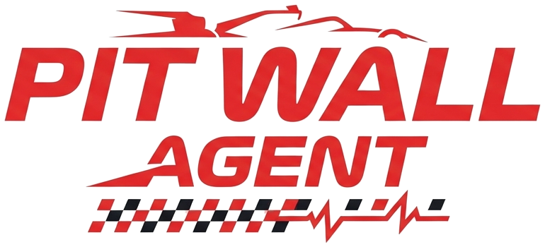
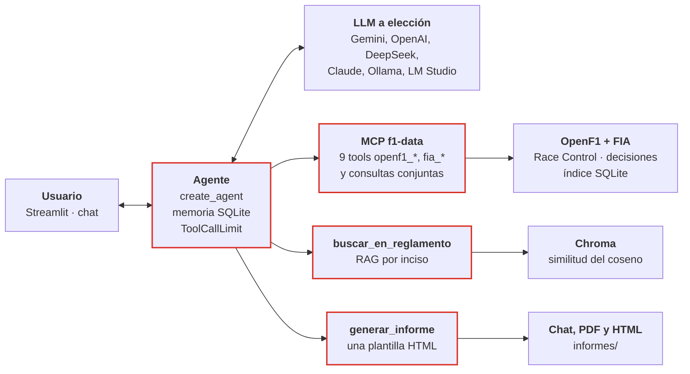

<p align="center">
  
</p>

<p align="center"><strong>Las sanciones de la Fórmula 1, explicadas con el reglamento en la mano.</strong></p>

En la transmisión ves "Bearman, reprimenda" o "+5 s", pero el porqué queda afuera. La decisión está en un PDF de los comisarios en fia.com, en inglés y con jerga legal, y cita un artículo de un reglamento de cientos de páginas que cambia cada temporada.

**Pit Wall Agent** resuelve eso en una pregunta. Busca qué se anunció en pista y qué decidieron los comisarios, trae el artículo exacto del reglamento de esa temporada y lo explica en simple, en un informe que se lee en el chat y se descarga en PDF.

## Qué le podés preguntar

| Pregunta | Qué devuelve |
|---|---|
| ¿Por qué sancionaron a Bearman en São Paulo 2026? | Todas sus sanciones de esa carrera, con la regla aplicada |
| ¿Cuál fue la última sanción de Hamilton? | Todas las suyas en la última carrera en la que lo sancionaron |
| ¿Quiénes fueron sancionados en la quinta carrera de 2025? | La carrera completa, identificada por número de ronda |
| ¿Qué sanciones hubo en Monza 2024? | La carrera, encontrada por lugar, país o circuito |
| ¿Por qué no sancionaron a Norris en esa carrera? | Las investigaciones que terminaron sin sanción |
| ¿Y en qué sesión fue? | Sigue la conversación: recuerda lo anterior |

La respuesta es un informe con un resumen de la carrera y una ficha por sanción: qué pasó, qué dice la regla, por qué correspondió esa sanción, el link al documento oficial y un glosario para quien recién empieza a seguir la F1.

## Cómo funciona



Así se resuelve "¿Por qué sancionaron a Bearman en São Paulo 2026?":

1. **`sanciones_de_piloto_completo`** identifica al piloto (auto 87, Haas), trae las decisiones de la FIA y las cruza con lo anunciado por Race Control.
2. **`buscar_en_reglamento`** recupera cada artículo citado, por ejemplo el B1.6.3b: *"At no time may an F1 Car be reversed in the Pit Lane under its own power."*
3. **`generar_informe`** arma el informe. El modelo escribe la explicación; la sanción, el artículo, la fecha y los links salen de las fuentes.

Mientras trabaja, la interfaz muestra en vivo el razonamiento del modelo y cada tool, con su fuente, argumentos y resultado. La respuesta se puede detener en cualquier momento.

### Una regla de diseño: el dato oficial no pasa por el modelo

El modelo decide qué consultar y explica en lenguaje simple, pero no copia datos oficiales. Al generar el informe, la decisión, el artículo, la fecha, el link y el texto del reglamento se completan directamente desde las fuentes. Así un error del modelo no puede cambiar una sanción ni inventar un artículo.

## De dónde sale cada dato

| Fuente | Qué aporta | Cómo se usa |
|---|---|---|
| **Decisiones de la FIA** | Hecho, infracción, artículos, sanción y motivo | Índice local de los documentos; cada PDF se lee una sola vez y queda en caché |
| **Race Control (OpenF1)** | Lo anunciado durante las sesiones: sanción, vuelta, si se cumplió, investigaciones y banderas | API pública, consultada en el momento |
| **OpenF1** | Pilotos, números de auto, equipos y calendario | Resuelve "Bearman", "la quinta carrera" o "Monza" |
| **Reglamentos de la FIA** | Texto vigente de cada temporada | Base vectorial con 3.651 párrafos |
| **Glosario propio** | 40 términos explicados para fans | Entra a la misma base que los reglamentos |

Las dos fuentes de sanciones se complementan. Race Control suele ser lo primero que aparece y da el momento exacto; la FIA da la explicación oficial, además de decisiones que no se anuncian en pista. Cada anuncio se cruza con su documento para no contar dos veces la misma sanción, y si todavía no hay documento, se muestra igual y queda marcado.

## Las piezas

### Servidor MCP `f1-data`

Los datos de F1 viven en un servidor [MCP](https://modelcontextprotocol.io) propio, separado del agente. El nombre de cada tool dice de qué fuente sale el dato, y el mismo servidor se puede usar desde otros clientes, como Claude Desktop o Claude Code.

| Tool | Fuente | Para qué |
|---|---|---|
| `sanciones_de_piloto_completo` | OpenF1 + FIA | Un piloto en una carrera |
| `sanciones_de_carrera_completo` | OpenF1 + FIA | Todas las sanciones de una carrera |
| `ultimas_sanciones_de_piloto_completo` | OpenF1 + FIA | La última carrera en la que sancionaron a un piloto |
| `fia_decisiones_de_piloto` | FIA | Decisiones de un piloto, en una carrera o en la temporada |
| `fia_decisiones_de_carrera` | FIA | Decisiones oficiales de una carrera |
| `openf1_sanciones_en_pista` | OpenF1 | Sanciones anunciadas por Race Control |
| `openf1_mensajes_race_control` | OpenF1 | Secuencia de un incidente |
| `openf1_buscar_piloto` | OpenF1 | Nombre a número de auto y equipo |
| `openf1_calendario` | OpenF1 | Rondas, lugares y fechas de una temporada |

El agente suma dos tools propias: `buscar_en_reglamento` y `generar_informe`.

### RAG del reglamento

Los comisarios citan incisos ("Breach of Article B1.6.3b"), así que **cada párrafo indexado es un inciso**. Como un inciso suelto tiene poco contexto, antes del embedding se le antepone su cita y el título del artículo:

```text
B1.6.3b · Driving in the Pit Entry Road, Pit Lane And Pit Exit Road
At no time may an F1 Car be reversed in the Pit Lane under its own power.
```

La búsqueda tiene dos pasos, siempre dentro de la temporada de la sanción:

1. Si hay un artículo citado, trae ese inciso exacto por metadatos.
2. Completa con los párrafos más parecidos por similitud del coseno, con un mínimo de 0,63. Con `gemini-embedding-001`, las consultas relevantes dieron entre 0,66 y 0,83, y las no relacionadas hasta 0,62.

Cada formato se detecta por su contenido. De los PDF bilingües del Código Deportivo y del Apéndice L se extrae solo la columna en inglés.

### Informe

Una sola plantilla (`agente_f1/informe/plantilla.html`, con Jinja2 y CSS) genera las tres salidas: la vista dentro del chat, el HTML descargable y el PDF con WeasyPrint. Si WeasyPrint no puede ejecutarse, el informe sigue disponible en HTML.

### Memoria y conversaciones

Cada conversación se guarda con el checkpointer de LangGraph en SQLite. Sobrevive a reinicios, permite preguntas de seguimiento y conserva sus informes, que aparecen debajo de ella en la barra lateral.

### Modelos

El proveedor y el modelo se eligen desde la interfaz. Cada usuario puede cargar su propia clave, que queda solo en la sesión del navegador. El razonamiento se muestra cuando el proveedor lo devuelve:

| Proveedor | Razonamiento en la interfaz |
|---|---|
| Gemini | Sí, resumen del razonamiento |
| OpenAI | Sí, en modelos de razonamiento |
| Anthropic | Sí, con extended thinking |
| DeepSeek | Sí con `deepseek-reasoner` |
| Ollama | Sí, en modelos con razonamiento como `qwen3` |
| LM Studio | No: se ven las tools |

### Límite de llamadas

`ToolCallLimitMiddleware` de LangChain, el único middleware, permite hasta 12 búsquedas en el reglamento y 30 llamadas a tools por pregunta. Existe porque un modelo llegó a buscar unas 30 veces seguidas un artículo que no estaba cargado. El prompt lo desalienta pero no lo garantiza; el límite actúa dentro del grafo, y al superarlo el modelo responde con lo que ya tiene. Se usa el de LangChain porque contar llamadas por ejecución es justo lo que ya resuelve.

## Puesta en marcha

Requiere Python 3.11 o superior, `pdftotext` (poppler) y Pango.

```bash
# Linux
sudo apt install poppler-utils libpango-1.0-0 libpangoft2-1.0-0
# macOS
brew install poppler pango

python -m venv .venv
source .venv/bin/activate          # Windows: .venv\Scripts\activate
pip install -r requirements.txt

cp .env.example .env               # completar GOOGLE_API_KEY
streamlit run app.py
```

En Windows, `pdftotext` se instala con `conda install -c conda-forge poppler`. Para el PDF hace falta el [runtime de GTK3](https://doc.courtbouillon.org/weasyprint/stable/first_steps.html#windows); sin él, el informe se genera en HTML.

El repositorio ya incluye el índice de la FIA y la base del reglamento, así que no hace falta generar datos para empezar.

| Variable | Uso |
|---|---|
| `GOOGLE_API_KEY` | **Obligatoria.** Embeddings del reglamento, y chat si se usa Gemini |
| `LLM_PROVIDER` | `gemini`, `openai`, `deepseek`, `anthropic`, `ollama` o `lmstudio` |
| `LLM_MODEL` | Opcional; vacío usa el modelo por defecto del proveedor |
| `OPENAI_API_KEY`, `DEEPSEEK_API_KEY`, `ANTHROPIC_API_KEY` | Opcionales; también se pueden cargar en la interfaz |

Con [Ollama](https://ollama.com) o [LM Studio](https://lmstudio.ai) no hace falta clave de chat, pero el modelo tiene que soportar tool calling. Por ejemplo: `ollama pull qwen3:8b`.

### Streamlit Community Cloud

1. Crear la app apuntando a este repositorio, rama `main`, archivo `app.py`, con Python 3.12.
2. Cargar `GOOGLE_API_KEY` y `LLM_PROVIDER` en **Secrets**, en formato TOML.

Las dependencias del sistema se instalan desde `packages.txt`. El disco es temporal: las conversaciones, los informes y lo agregado al caché se pierden al reiniciar. Si la app es pública, cualquiera que la use consume las claves cargadas.

### Usar el servidor MCP en otro cliente

```json
{
  "mcpServers": {
    "f1-data": {
      "command": "/ruta/al/proyecto/.venv/bin/python",
      "args": ["-m", "agente_f1.mcp_f1"],
      "cwd": "/ruta/al/proyecto"
    }
  }
}
```

## Actualizar los datos

**Documentos de la FIA.** Se actualizan solos: antes de cada consulta se revisa en OpenF1 si hubo sesiones nuevas y se refresca esa carrera. Para reconstruir el índice desde cero (unos 35 minutos, respetando los 10 segundos entre pedidos que pide fia.com):

```bash
rm data/fia_cache.sqlite
python scripts/indexar_fia.py
```

**Reglamentos.** Los PDF no están en el repositorio. Para regenerar la base, descargarlos en `data/reglamento/` con estos nombres; el año del nombre define la temporada.

| Archivos | Documento | Descarga |
|---|---|---|
| `2026_f1_regulations_section_b_sporting_iss09.pdf`, `2025_f1_sporting_regulations_iss05.pdf`, `2024_f1_sporting_regulations_iss07.pdf` | Reglamento Deportivo de F1 | [fia.com](https://www.fia.com/regulation/category/110) |
| `2026_international_sporting_code.pdf`, `2025_international_sporting_code.pdf`, `2024_international_sporting_code.pdf` | Código Deportivo Internacional | [fia.com](https://www.fia.com/regulation/category/123) |
| `2026_isc_appendix_l.pdf`, `2025_isc_appendix_l.pdf`, `2024_isc_appendix_l.pdf` | Apéndice L, capítulo IV | [fia.com](https://www.fia.com/regulation/category/123) |

```bash
python scripts/ingestar_reglamento.py              # agrega lo que falta
python scripts/ingestar_reglamento.py --max 800    # limita los párrafos de esta corrida
python scripts/ingestar_reglamento.py --desde-cero # borra la base y carga todo
```

El plan gratuito de `gemini-embedding-001` permite 100 embeddings por minuto y 1.000 por día, compartidos con las búsquedas del agente. La ingesta va en lotes y retoma donde quedó: con una sola clave gratuita, la base completa lleva cuatro días.

## Estructura del proyecto

```text
app.py                  interfaz de chat (Streamlit)
agente_f1/
  agent.py              agente, instrucciones y límites
  conversaciones.py     memoria e historial
  llm/                  adaptadores de proveedores y listado de modelos
  mcp_f1/               servidor MCP f1-data y su cliente
  fuentes/              OpenF1, calendario, FIA y cruce entre fuentes
  rag/                  ingesta y búsqueda en el reglamento
  informe/              datos, plantilla y generación de HTML y PDF
  tools/                tools propias del agente
data/                   índice FIA, base vectorial y glosario
scripts/                indexar la FIA e ingerir el reglamento
static/                 estilos, logo y tipografías
tests/                  pruebas sin red ni claves
```

Para correr las pruebas: `python -m pytest`.

## Limitaciones

- El reglamento cubre 2024, 2025 y 2026. Las decisiones de la FIA están indexadas desde 2019, y Race Control está disponible desde 2023.
- Hay una versión del reglamento por año. Si la versión cargada es posterior a la decisión, se avisa, porque el texto o la numeración pueden haber cambiado.
- Algunas decisiones se apoyan en las notas del director de carrera de cada Gran Premio, que no están cargadas.
- Las sanciones que solo figuran en Race Control no tienen artículo citado: se muestra una regla relacionada, identificada como tal.
- Los documentos especiales de la FIA, como apelaciones o derechos de revisión, pueden leerse de forma incompleta.
- Si la descarga de un PDF de la FIA falla, queda marcada y ese documento no se reintenta.
- La primera lectura de un documento puede demorar por la pausa de 10 segundos entre pedidos a fia.com.
- Los modelos locales chicos pueden equivocarse con los argumentos de las tools.
